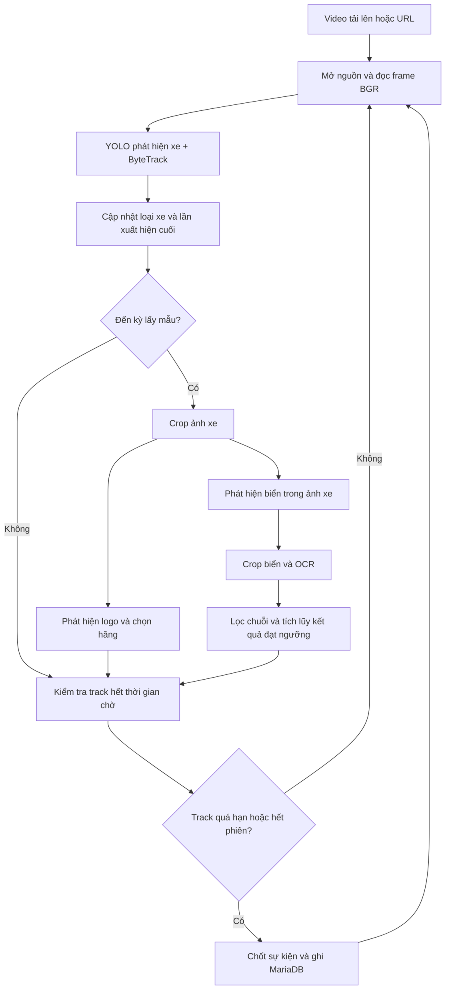

# Thuật toán xử lý nhận diện xe và biển số

Tài liệu mô tả bản thử nghiệm trong `lane_video_demo`, cập nhật ngày 18/11/2026.
Các giá trị dưới đây là cấu hình đang được gọi trong mã nguồn, không phải ngưỡng đã được nghiệm thu trên camera thực tế.

## 1. Mục tiêu và định nghĩa

Đầu vào là video hoặc luồng hình ảnh. Đầu ra là sự kiện gồm loại xe, hãng và biển số nếu đọc được.

- **Detection:** một hộp đối tượng được model phát hiện trong một khung hình.
- **Track:** chuỗi quan sát được ByteTrack gán cùng ID trong một nguồn.
- **Mẫu nhận diện:** ảnh xe được lấy từ track để chạy model logo và biển số.
- **Sự kiện:** bản tổng hợp của track khi track hết thời gian chờ hoặc phiên kết thúc bình thường.

Một track không bảo đảm tương ứng duy nhất với một xe ngoài đời. Che khuất, mất dấu hoặc thay đổi ID có thể khiến một xe tạo nhiều sự kiện.
Hiện chưa dùng vạch đếm, vùng làn hoặc cảm biến để xác định lượt xe.

## 2. Luồng tổng thể



Nhánh quay lại đọc frame chỉ tiếp tục khi nguồn chưa kết thúc và chưa đạt giới hạn thời lượng.

## 3. Bước 1 — Tiếp nhận và chuẩn hóa nguồn

Mã nguồn: `sources.py`, `app.py`.

| Nguồn | Cách đọc |
|---|---|
| Video tải lên | Ghi file tạm, mở bằng `cv2.VideoCapture` |
| HTTP/HTTPS, RTSP/RTSPS trực tiếp | FFmpeg xuất raw video qua stdout |
| YouTube hoặc chế độ trang web | `yt-dlp → FFmpeg → stdout` |

`stream_source()` nhận biết hostname YouTube hoặc lựa chọn trang web trên giao diện,
sau đó thêm tiền tố nội bộ `web://`. Tiền tố này không phải URL gửi tới nhà cung cấp.

FFmpeg:

1. Co ảnh giữ tỷ lệ vào khung 1280 × 720.
2. Thêm viền để đủ kích thước.
3. Xuất 30 FPS, định dạng `bgr24`.
4. Mỗi frame có `1280 × 720 × 3 = 2.764.800` byte.
5. Vòng đọc gom đủ số byte trước khi chuyển thành mảng NumPy.

File cục bộ giữ kích thước/FPS do OpenCV trả về; không áp dụng bước resize FFmpeg nói trên.
FPS không dương được pipeline thay bằng 25.

Lưu ý:

- Co nguồn độ phân giải cao xuống 720p có thể làm biển số nhỏ hơn.
- Link trang web chỉ hoạt động khi yt-dlp hỗ trợ và có quyền truy cập.
- Chưa có tự kết nối lại, hàng đợi frame mới nhất hoặc timeout tổng thể cho mọi bước.
- `-rw_timeout 15000000` là tùy chọn I/O của FFmpeg cho nguồn trực tiếp; không phải bảo đảm mọi lần đọc sẽ kết thúc trong 15 giây.
- Lỗi chuẩn của tiến trình hiện được chuyển sang `DEVNULL`, nên thông báo lỗi nguồn còn hạn chế.

## 4. Bước 2 — Phát hiện và theo dõi xe

Mã nguồn: `pipeline.py::analyze_video`.

Mỗi nguồn tạo một instance `YOLO(vehicle_weights)` riêng. Mỗi frame gọi:

```python
detector.track(
    frame,
    persist=True,
    tracker="bytetrack.yaml",
    classes=[2, 3, 5, 7],
    conf=0.2,
    verbose=False,
)
```

| ID COCO | Nhãn sử dụng |
|---|---|
| 2 | Ô tô con |
| 3 | Xe máy |
| 5 | Xe buýt |
| 7 | Xe tải |

ByteTrack duy trì liên kết đối tượng qua nhiều frame. Cơ chế ghép detection,
ước lượng chuyển động và các ngưỡng nội bộ phụ thuộc thư viện Ultralytics cùng file
`bytetrack.yaml` được cài. Dự án chưa cung cấp bản cấu hình tracker riêng.

Chỉ detection có `track_id` mới được đưa vào quản lý sự kiện.
Nếu thay model loại xe, phải bảo đảm class ID tương thích hoặc sửa bảng `VEHICLES`.

## 5. Bước 3 — Tổng hợp loại xe

Với mỗi quan sát thuộc track, cộng confidence của detection vào lớp tương ứng:

```text
score[class] ← score[class] + detection_confidence
loại xe cuối = argmax_class score[class]
```

Đây là bỏ phiếu bằng tổng confidence, không đơn thuần lấy nhãn của frame cuối.
Confidence tổng không được xuất như xác suất chính xác của sự kiện.

Mỗi track lưu:

| Trường nội bộ | Ý nghĩa |
|---|---|
| `time` | Thời điểm đầu tiên, tính bằng `frame_idx / fps` |
| `scores` | Tổng confidence theo loại xe |
| `brand`, `brand_score` | Hãng tốt nhất và confidence tương ứng |
| `plates` | Chuỗi biển và danh sách confidence được giữ |
| `last_sample` | Frame lấy mẫu nhận diện gần nhất |
| `last_seen` | Frame quan sát gần nhất |

## 6. Bước 4 — Lấy mẫu nhận diện

```text
sample_every = max(1, round(fps / 2))
```

Mỗi track được lấy mẫu xấp xỉ hai lần trong một giây nội dung, không phải hai lần
trong một giây thời gian chạy trên máy. Model xe vẫn chạy trên từng frame.

Chỉ lấy mẫu khi có model logo hoặc có đủ detector biển và OCR.
Hộp xe được cắt theo biên ảnh. Crop rỗng không được suy luận tiếp.

Hệ quả:

- Xe xuất hiện rất ngắn có thể chỉ có một mẫu.
- Chi tiết biển bị detector xe cắt mất sẽ không tới bước OCR.
- Dự án chưa có nhánh phát hiện biển độc lập trên toàn khung hình.

## 7. Bước 5 — Nhận diện hãng

Mã nguồn: `pipeline.py::recognize_vehicle`.

1. Chạy `models/logo.pt` trên ảnh crop xe với `conf=0.4`.
2. Chọn hộp logo có confidence lớn nhất trong mẫu.
3. Thay hãng của track nếu confidence mới lớn hơn `brand_score`.
4. Tên hãng lấy từ `logo_model.names`.

Như vậy hãng là kết quả có confidence cao nhất trong các mẫu, không bỏ phiếu theo số lần xuất hiện.
Không thấy logo hoặc nhãn hãng không có trong model thì hãng có thể để trống.

## 8. Bước 6 — Phát hiện biển

1. Chạy `models/best_stripped.onnx` trên crop xe.
2. Dùng `conf=0.35`.
3. Chọn một hộp có confidence cao nhất.
4. Crop đúng hộp đó để đưa vào OCR.

Hiện chưa:

- Nới hộp crop bằng padding.
- Nắn phối cảnh hoặc xoay biển.
- Tách hai hàng rồi ghép lại.
- Đánh giá độ nét/kích thước tối thiểu trước OCR.
- Thử nhiều hộp biển cho cùng một mẫu.

Biển hai hàng hiện được đưa nguyên ảnh vào model CCT; kết quả phụ thuộc dữ liệu
huấn luyện và khả năng model, không có bước xử lý hai hàng riêng trong code.

## 9. Bước 7 — OCR CCT-VN

Mã nguồn: `recognition.py::VietnamesePlateRecognizer`.

### 9.1. Tiền xử lý

Với cấu hình model hiện có:

```text
Crop BGR
  → đổi RGB
  → resize tuyến tính tới 128 × 64
  → uint8
  → thêm chiều batch
  → tensor [1, 64, 128, 3]
```

Adapter dùng chiều cao, chiều rộng, alphabet và padding từ YAML.
Đổi RGB, kiểu uint8 và resize tuyến tính đang được quy định trong code,
không tự suy ra cho một model ONNX bất kỳ.

Không chuẩn hóa về `[0,1]` hoặc `[-1,1]`, không đổi sang NCHW.
Đây là hợp đồng đầu vào của CCT đóng gói, khác CRNN bên VN-ANPR.

ONNX Runtime ưu tiên CUDA nếu provider có sẵn, sau đó CPU.
Cài gói `onnxruntime` thông thường không đồng nghĩa đã bật GPU.

### 9.2. Giải mã

Model đóng gói xuất `[batch, 9, 37]`: 9 vị trí ký tự, 37 lớp gồm padding `_`.

```text
Tại mỗi vị trí:
    chọn lớp có xác suất lớn nhất
    đổi chỉ số thành ký tự theo alphabet
    bỏ ký tự padding
    giữ nguyên ký tự lặp
```

Đây là giải mã theo vị trí, **không phải CTC**. Ví dụ `30A11234_` thành
`30A11234`, không được gộp `11` thành `1`.

Điểm OCR:

```text
ocr_score = trung bình xác suất của các ký tự không phải padding
```

Điểm này chưa được hiệu chuẩn thành xác suất toàn bộ biển đúng.

### 9.3. Lọc chuỗi

`inspect_plate()`:

1. Chuyển thành chữ hoa.
2. Chỉ giữ `A–Z` và `0–9`.
3. Chấp nhận nếu độ dài từ 5 đến 11 và điểm ≥ 0,65.

Model CCT hiện có tối đa 9 vị trí; ngưỡng độ dài 11 là điều kiện chung của adapter đầu ra,
không mở rộng khả năng sinh ký tự của CCT.

Không có kiểm tra văn phạm biển Việt Nam, mã tỉnh hoặc sửa nhầm O/0, I/1.
Ký tự `Đ` không nằm trong bộ lọc hiện tại.

Kết quả chưa đạt vẫn được đưa lên bảng chẩn đoán nhưng không thêm vào phiếu biển số.
`read_plate()` là hàm tiện ích trả chuỗi rỗng khi không đạt; pipeline hiện gọi trực tiếp
`inspect_plate()` để giữ thông tin chẩn đoán.

PaddleOCR REC là lựa chọn khác qua giao diện; cần thư viện và inference model tương thích riêng.

## 10. Bước 8 — Tổng hợp biển qua nhiều mẫu

Với mỗi chuỗi được chấp nhận, lưu confidence vào danh sách của chuỗi:

```text
plates[text].append(score)
```

Giới hạn:

- Tối đa 30 confidence gần nhất cho mỗi chuỗi.
- Tối đa 20 chuỗi khác nhau cho mỗi track.
- Khi vượt số chuỗi, xóa chuỗi yếu nhất theo tiêu chí bên dưới.

Xếp hạng chuỗi theo bộ:

```text
(số mẫu đang giữ, confidence lớn nhất trong các mẫu)
```

Chuỗi nhiều mẫu nhất thắng; khi bằng nhau, chuỗi có confidence lớn nhất thắng.
Do giới hạn 30 mẫu, số mẫu đang giữ không phải tổng số lần đọc trong cả vòng đời track.

Ví dụ:

| Chuỗi | Điểm các mẫu | Kết quả |
|---|---|---|
| `30A11234` | 0,82; 0,87; 0,85 | Được chọn vì có 3 mẫu |
| `30A11284` | 0,95 | Không được chọn dù điểm một mẫu cao hơn |

Hiện không yêu cầu tối thiểu hai lần đọc hoặc tỷ lệ đồng thuận.
Một mẫu đạt ngưỡng cũng có thể trở thành biển của sự kiện.

## 11. Bước 9 — Chốt sự kiện

Sau khi xử lý frame, kiểm tra từng track:

```text
frame_idx - last_seen > round(fps × 2)
```

Dấu so sánh là `>`: thời điểm chốt thực tế là frame đầu tiên vượt ngưỡng.

Track được chốt khi:

1. Không xuất hiện vượt thời gian chờ trên.
2. Nguồn hết/không đọc được frame tiếp theo sau khi đã đọc ít nhất một frame.
3. Đạt giới hạn thời lượng nội dung do người dùng nhập.

Khi kết thúc bình thường, các track còn hoạt động đều được chốt.
Nếu có exception hoặc dừng tiến trình, code chỉ bảo đảm vào nhánh giải phóng capture
trong các trường hợp Python xử lý được; chưa bảo đảm chốt hết track đang hoạt động.

Sự kiện không có biển vẫn được ghi với `Biển số: ""`.
Hiện không có trạng thái sự kiện `ACCEPT/UNREAD/LOW_QUALITY` như dự án VN-ANPR.

`on_event(row)` được gọi đồng bộ, sau đó track bị loại khỏi bộ nhớ quản lý.
UI dùng `collect_results=False` vì sự kiện đã ghi vào MariaDB;
hàm vẫn hỗ trợ trả danh sách khi `collect_results=True`.

## 12. Thời gian, hiển thị và chẩn đoán

- `Xuất hiện (giây)`: frame đầu được quan sát / FPS.
- `Kết thúc (giây)`: frame cuối được quan sát / FPS; không phải lúc chốt.
- `recorded_at`: thời điểm ghi database, UTC.
- Với stream, thời gian nội dung không đồng nghĩa thời gian camera thực tế khi có độ trễ/buffering.

Video xem trước cập nhật mỗi 10 frame. Nhãn gồm hộp xe do Ultralytics vẽ,
biển đã tổng hợp và hãng; chưa vẽ hộp biển riêng lên toàn khung hình.

Chẩn đoán cho mỗi nguồn:

| Trường | Ý nghĩa |
|---|---|
| `samples` | Số mẫu xe đã gọi nhận diện |
| `plate_detections` | Số mẫu có crop biển không rỗng và đã chạy OCR |
| `accepted_reads` | Số mẫu OCR đạt bộ lọc |
| `status` | Trạng thái của mẫu gần nhất |
| `text`, `score` | Chuỗi chuẩn hóa và điểm OCR của mẫu gần nhất |
| `image` | Crop xe khi chưa tìm được biển, hoặc crop biển |
| `track_id` | Track của mẫu gần nhất |

Các bộ đếm này không phải số xe duy nhất. Chẩn đoán được cập nhật mỗi 10 frame
và ở cuối phiên; giao diện chỉ giữ mẫu gần nhất, không hiển thị hết mọi lần suy luận.

## 13. Bảng thông số hiện tại

| Thông số | Giá trị | Vị trí |
|---|---|---|
| Model xe | `models/yolo11n.pt` | `app.py` |
| Confidence xe | 0,2 | `pipeline.py::analyze_video` |
| Tracker | `bytetrack.yaml` | `pipeline.py::analyze_video` |
| Confidence logo | 0,4 | `pipeline.py::recognize_vehicle` |
| Confidence detector biển | 0,35 | `pipeline.py::recognize_vehicle` |
| Chu kỳ OCR/logo | `round(fps/2)` frame, tối thiểu 1 | `pipeline.py::analyze_video` |
| Ngưỡng OCR | 0,65 | `recognition.py::inspect_plate` |
| Độ dài chuỗi | 5–11 | `recognition.py::inspect_plate` |
| Chờ mất dấu | Vượt 2 giây nội dung | `TRACK_TIMEOUT_SECONDS` |
| Số mẫu mỗi chuỗi | 30 | `MAX_PLATE_SAMPLES` |
| Số chuỗi mỗi track | 20 | `MAX_PLATE_CANDIDATES` |
| Chu kỳ xem trước | 10 frame | `PREVIEW_EVERY_FRAMES` |
| Đầu ra FFmpeg | 1280 × 720, 30 FPS | `sources.py` |
| Giới hạn phiên mặc định | 60 giây nội dung mỗi nguồn | `app.py` |

## 14. Giới hạn và hướng đánh giá

Thời gian một frame phụ thuộc model xe, số xe cần lấy mẫu, model logo/biển/OCR,
vẽ ảnh và cập nhật UI. Chưa có số FPS/độ trễ cam kết cho phần cứng cụ thể.

Phải đánh giá bằng video có nhãn để xác định:

- Tỷ lệ phát hiện xe và biển.
- Exact match của chuỗi biển.
- Tỷ lệ biển sai trong các sự kiện có biển.
- Số sự kiện thiếu/trùng theo lượt xe thực.
- Thời gian từ lúc xe xuất hiện/rời vùng đến lúc sự kiện được ghi.

Tham khảo quy trình kiểm thử trong [tài liệu dự án](TAI_LIEU_DU_AN.md).
